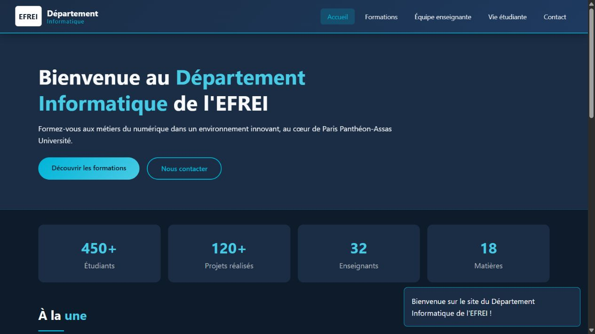
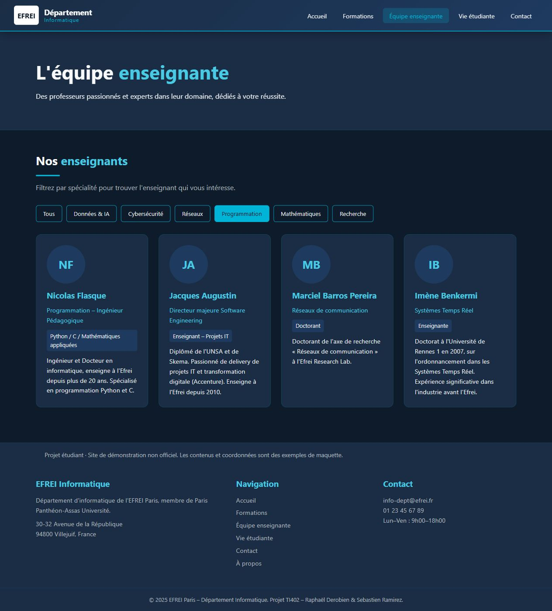
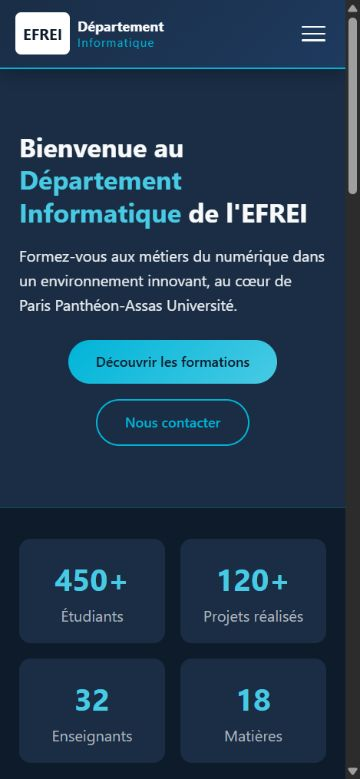

# Site vitrine EFREI Informatique

## Essayer dans le navigateur

**[Ouvrir la démonstration](https://sebastienrmz.github.io/projet-web1/)**

Aucune installation nécessaire. Essayer le carrousel de l’accueil, le filtre des enseignants et la validation du formulaire de contact. Le formulaire est une démonstration : aucun message n’est envoyé. Il s’agit d’un projet étudiant, pas du site officiel de l’EFREI.

Projet réalisé en binôme dans le cadre du cours TI402 – Programmation Web à l'EFREI.

Le site présente des formations, une équipe enseignante, la vie étudiante et un formulaire de contact. Il utilise HTML, CSS et JavaScript, sans framework.

## Aperçu

La page d'accueil sur ordinateur, une rubrique du site et la version mobile :







## Ouvrir le site

Télécharger le dépôt et ouvrir `index.html` dans un navigateur. Aucun outil de compilation n'est nécessaire.

On peut aussi lancer un serveur local depuis le dossier du projet :

```sh
python -m http.server 8000
```

Ouvrir ensuite `http://localhost:8000`.

## Fichiers utiles

- `index.html` : accueil et carrousel.
- `formations.html` : présentation des matières.
- `enseignants.html` : cartes et filtre par spécialité.
- `vie-etudiante.html` : événements et associations.
- `contact.html` : validation du formulaire dans le navigateur.
- `apropos.html` : présentation du travail du binôme.
- `css/styles.css` et `js/script.js` : styles et interactions communes.

Les anciennes copies sans extension ont été retirées pour éviter les doublons. La page `projets.html` et le logo local n'étaient pas fournis : les liens correspondants ont été retirés et le nom du département reste affiché en texte.

## Ce que nous avons travaillé

La navigation mobile, le carrousel, le filtrage des enseignants et les messages d'erreur du formulaire sont gérés en JavaScript. La mise en page utilise Flexbox, Grid et des media queries.

Le formulaire est une démonstration : il ne transmet aucun message et ne possède pas de serveur. Le site est un projet étudiant, pas le site officiel de l'école. Certaines photos utilisent des liens externes ; les informations de la maquette et les coordonnées n'ont pas été actualisées ni vérifiées.

## Répartition du travail

- Raphaël Derobien : design, CSS et pages Accueil / Projets / Vie étudiante.
- Sébastien Ramirez : JavaScript et pages Formations / Enseignants / Contact / À propos.

La répartition ci-dessus reprend celle du README d'origine. La page Projets mentionnée dans ce travail n'est pas présente dans le dépôt actuel.
